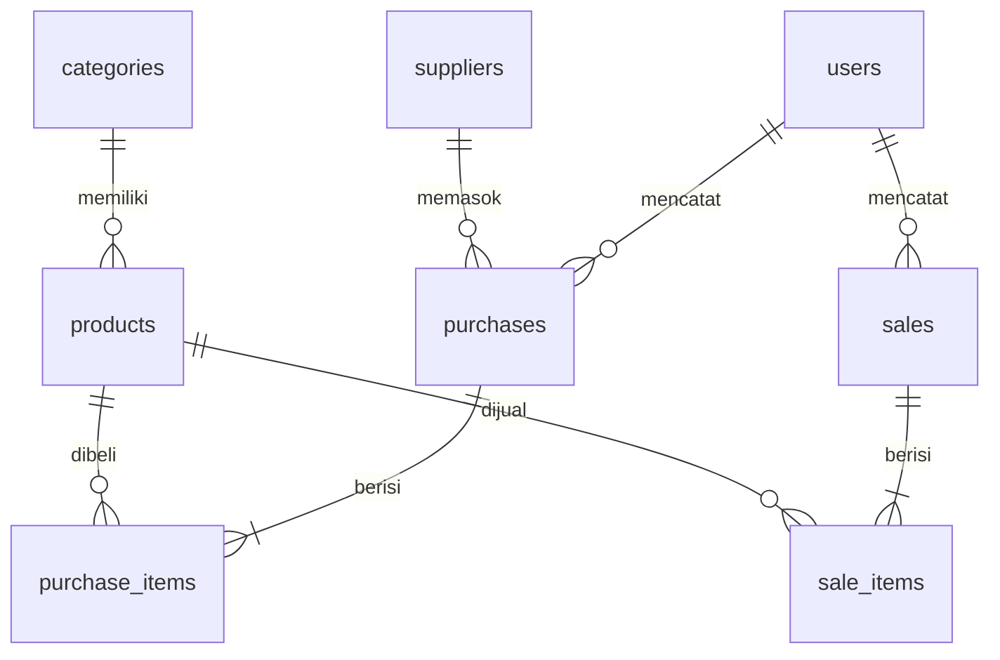
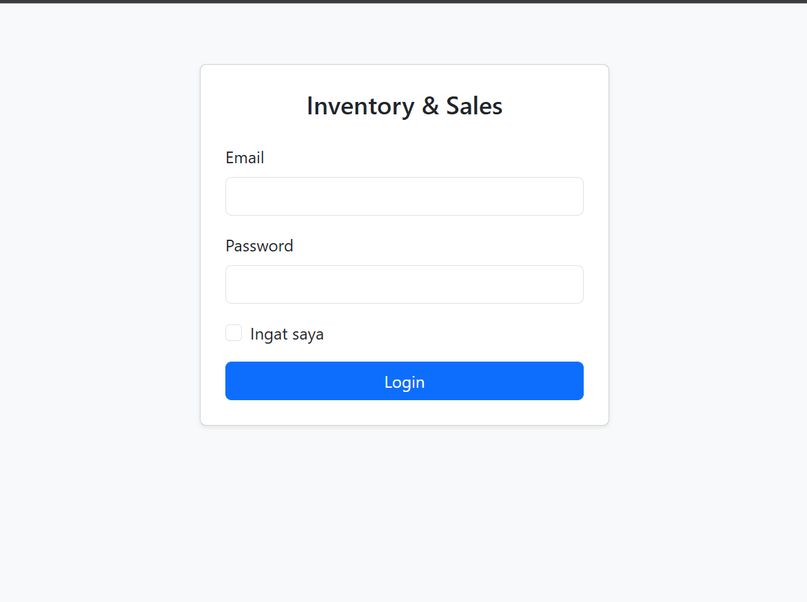
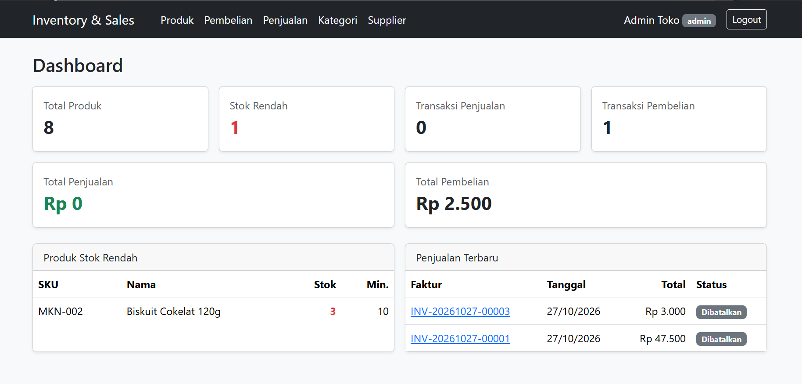
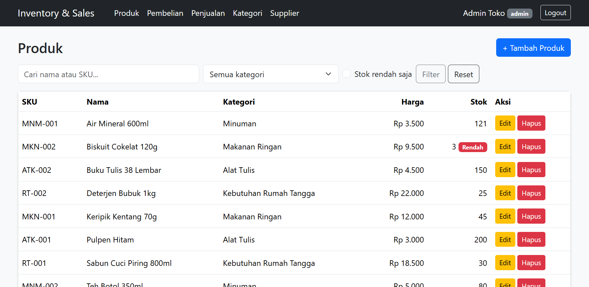
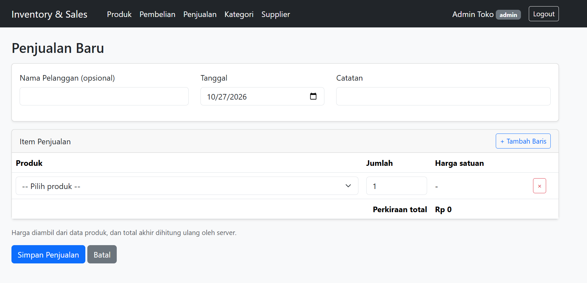
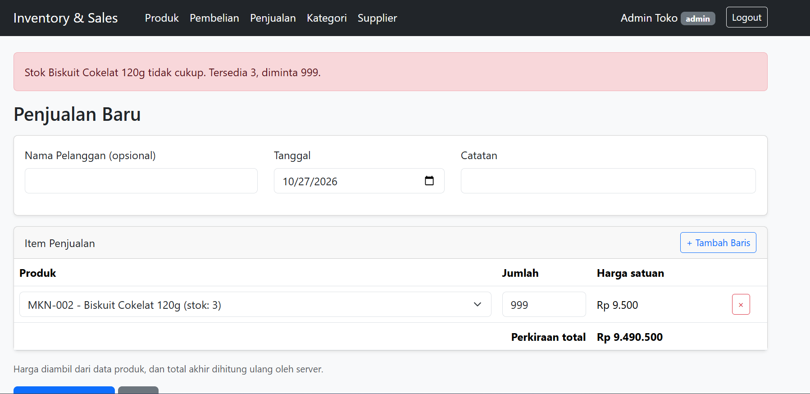
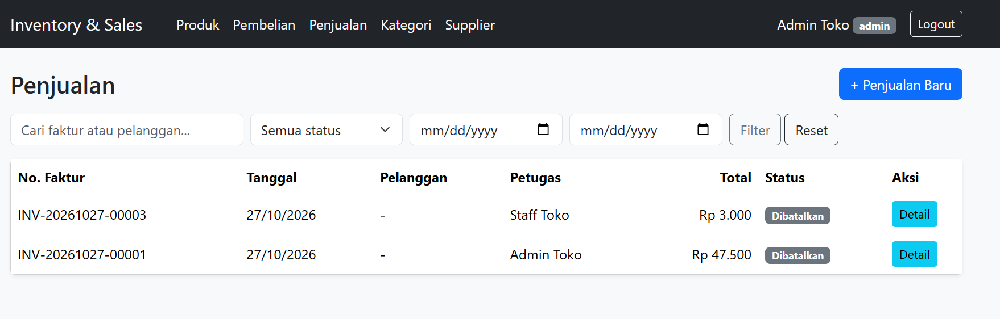
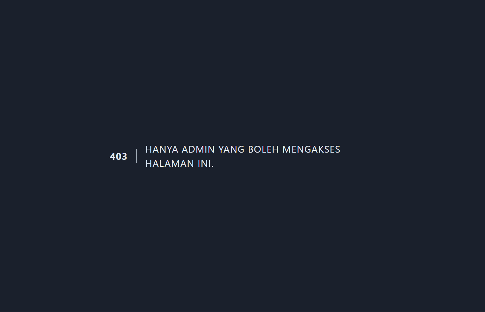

# Inventory & Sales Management System

Aplikasi web manajemen produk, pemasok, pembelian (stok masuk), dan penjualan (stok keluar) untuk usaha distribusi kecil. Dibuat untuk UTS Pemrograman Web.

## Teknologi

- PHP 8.2+, Laravel 12
- MySQL
- Blade + Bootstrap 5 (via CDN)

## Fitur

- Login/logout dengan password ter-hash, route diproteksi middleware
- Dua role: **Admin** dan **Staff**
- CRUD Kategori, Supplier, Produk (SKU unik, soft delete)
- Pembelian: stok bertambah, mendukung banyak item
- Penjualan: stok berkurang, ditolak jika stok tidak cukup
- Pembatalan transaksi (admin) yang mengembalikan stok
- Dashboard dengan angka dari database
- Search, filter (kategori, status, tanggal, stok rendah), dan pagination
- Upload foto produk (opsional, JPG/PNG/WEBP, maks. 2 MB)

## Hak Akses

| Fitur | Admin | Staff |
|---|---|---|
| Lihat produk | Ya | Ya |
| Kelola kategori, supplier, produk | Ya | Tidak |
| Buat pembelian dan penjualan | Ya | Ya |
| Lihat transaksi | Semua | Miliknya saja |
| Batalkan transaksi | Ya | Tidak |

## Instalasi

Prasyarat: PHP 8.2+, Composer, MySQL (XAMPP juga bisa).

```bash
git clone https://github.com/talitha250180171-cmd/inventory-sales.git
cd inventory-sales
composer install
copy .env.example .env
php artisan key:generate
```

Buat database kosong bernama `inventory_sales` di MySQL, lalu ubah bagian database di file `.env`:

```
DB_CONNECTION=mysql
DB_HOST=127.0.0.1
DB_PORT=3306
DB_DATABASE=inventory_sales
DB_USERNAME=root
DB_PASSWORD=
```

Jalankan migration dan seeder, lalu server:

```bash
php artisan migrate --seed
php artisan storage:link
php artisan serve
```

Buka http://127.0.0.1:8000

## Akun Demo

| Role | Email | Password |
|---|---|---|
| Admin | admin@example.com | password123 |
| Staff | staff@example.com | password123 |

## Business Rules

- Total transaksi dihitung di server, bukan dipercaya dari form
- Harga penjualan diambil dari database
- Seluruh proses transaksi (header, item, perubahan stok) berjalan dalam `DB::transaction`; jika satu langkah gagal, semuanya dibatalkan (rollback)
- Penjualan ditolak jika stok tidak cukup
- Pembatalan pembelian ditolak jika stok sudah terpakai (mencegah stok negatif)
- Produk tidak di-hard delete (soft delete) agar riwayat transaksi tetap utuh
- Kategori dan supplier yang masih dipakai tidak bisa dihapus
- Otorisasi dijaga di server (middleware dan pengecekan kepemilikan), bukan sekadar menyembunyikan tombol

## ERD



Relasi Eloquent: `Category hasMany Product`, `Product belongsTo Category`, `Purchase hasMany PurchaseItem`, `Sale hasMany SaleItem`, `Supplier hasMany Purchase`, `User hasMany Purchase/Sale`.

## Pengujian (manual)

| No | Skenario | Hasil yang diharapkan | Hasil |
|---|---|---|---|
| 1 | Login dengan password salah | Ditolak, muncul pesan error | Lulus |
| 2 | Akses `/dashboard` tanpa login | Diarahkan ke halaman login | Lulus |
| 3 | Staff membuka `/categories` | Halaman 403 | Lulus |
| 4 | Tambah SKU produk yang sudah ada | Ditolak oleh validasi | Lulus |
| 5 | Pembelian 2 item | Stok kedua produk bertambah, total benar | Lulus |
| 6 | Penjualan 2 item | Stok kedua produk berkurang, harga dari database | Lulus |
| 7 | Penjualan melebihi stok | Ditolak, tidak ada data tersimpan (rollback) | Lulus |
| 8 | Produk yang sama dua kali dalam satu transaksi | Ditolak | Lulus |
| 9 | Batalkan penjualan | Status cancelled, stok kembali | Lulus |
| 10 | Staff membuka detail transaksi milik user lain | Halaman 403 | Lulus |
| 11 | Search dan filter pada daftar produk | Hasil sesuai filter | Lulus |
| 12 | Tambah produk dengan harga negatif | Ditolak oleh validasi | Lulus |
| 13 | Pindah halaman pagination saat filter aktif | Filter tetap terjaga | Lulus |

## Tampilan Aplikasi

**Login**



**Dashboard**



**Daftar Produk**



**Form Penjualan**



**Penjualan Ditolak karena Stok Tidak Cukup**



**Detail Penjualan**



**Akses Ditolak untuk Staff**



## Limitasi

- SKU produk yang sudah dihapus (soft delete) tidak bisa dipakai ulang
- Belum ada fitur retur sebagian atau pembayaran
- Pengujian masih manual, belum memakai automated test
- Foto produk yang diunggah tidak ikut repository; produk dari seeder tampil dengan ikon pengganti